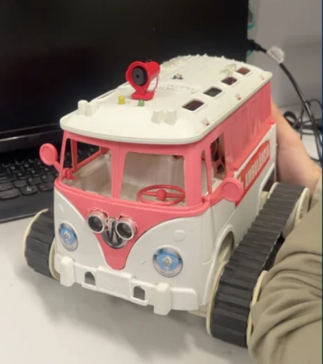

# chon-collision-avoidance

Agentes [Jason](https://jason-lang.github.io) (BDI) que controlam um pequeno robô de esteiras em formato de Kombi-ambulância rosa. Uma pessoa manda `walk` e `stop` por um chat, o robô consulta um semáforo antes de andar e se afasta sozinho de obstáculos.

Feito por uma equipe de seis pessoas no curso e hackathon da IEEE IES na UFSC.



## Como funciona

Dois agentes dividem o trabalho. O `telefonista` cuida de tudo que está fora do robô: conecta ao servidor ContextNet, recebe `achieve(walk)` e `achieve(stop)` de uma pessoa pelo MAS Chat e decide se um `walk` é permitido. O `chonbot_agent` cuida do hardware: lê o sensor ultrassônico da frente e comanda motores, luzes e buzzer.

O `chonbot_agent` não fala com o Arduino diretamente. Suas ações viram escritas em tópicos ROS, e uma ponte Javino repassa tudo para a placa. A leitura do sensor faz o caminho inverso e chega ao agente como a crença `distance`.

```
pessoa (MAS Chat) ──▶ telefonista ◀── agente do semáforo (ContextNet)
                          │
                          ▼
                    chonbot_agent
                          │  rosbridge (WebSocket, porta 9090)
                          ▼
         ROS 2 ─ ponte Javino ─ Arduino (motores, luzes, buzzer, sensor)
```

## Regras de decisão

| Evento | Condição | O que acontece |
|---|---|---|
| `walk` da pessoa | semáforo green ou blue | `telefonista` responde "Walk recebido" e repassa o `walk` ao `chonbot_agent` |
| `walk` da pessoa | qualquer outro estado | recusado; só aparece uma linha no log, a pessoa não recebe resposta |
| `stop` da pessoa | sempre | `telefonista` repassa ao `chonbot_agent`, que descarta a intenção `walk` e para os motores |
| semáforo fica red | a qualquer momento | `telefonista` manda `stop` sozinho |
| obstáculo | `distance` ≤ 50 | luz de freio, buzzer por 1 s, ré por 1 s, pausa de 0,5 s, giro à direita por 2 s e volta a andar |

O valor de `distance` vem do tópico `/arduino/ultrasonic_sensor/distance`.

O desvio fica todo no `chonbot_agent` e não precisa de novo comando, então uma leitura do sensor pode interromper um movimento que a pessoa já tinha autorizado. É uma sequência fixa, não planejamento de rota: o limite e os tempos estão escritos direto no `chonbot_agent.asl`. Enquanto os motores não estão em movimento, o pisca-alerta fica piscando.

## O que funciona e o que não funciona

No robô físico, conseguimos fazê-lo andar por comando, desviar de obstáculos e seguir a lógica do semáforo.

O semáforo foi **simulado**. A consulta real ao agente do semáforo do curso (`askOne` pelo ContextNet) está comentada no `telefonista.asl`, porque a conexão com o servidor compartilhado estava ruim durante o hackathon. No lugar dela, o plano `!atualiza` troca o estado localmente: green por 15 s, depois red por cerca de 10 s, em loop. Isso exercita a parada no vermelho, mas não o caminho pela rede.

Lacunas conhecidas:

- Nada trata a perda de conexão com o semáforo. O `telefonista` guarda o último estado recebido, então, se o link cair com o sinal verde, o robô continua liberado para andar.
- Depois de um sinal vermelho o robô não retoma sozinho. É preciso enviar um novo `walk` quando o sinal mudar.

## Como rodar

Você precisa do ambiente do curso: ROS 2 com `rosbridge_server`, o pacote ROS `my_py_pkg` (que traz a ponte Javino), Java, e o robô ligado ao computador.

1. Em um terminal, `bash setup.sh`. Isso sobe o rosbridge (WebSocket na porta 9090) e a ponte Javino.
2. Em outro terminal, `./gradlew run`. Isso inicia o MAS definido em `obstacle_avoidance_vehicle.jcm`.
3. O `telefonista` imprime no console um link do MAS Chat. Abra e envie `walk` ou `stop`.

As configurações de conexão do `telefonista.asl` (servidor, porta, UUID do agente e UUID do semáforo) pertencem ao ambiente do curso. Troque pelas suas.

## Estrutura

- `src/agt/`: os dois agentes e o `chonbot_agent.yaml`, que liga tópicos ROS a crenças e ações a escritas de tópico
- `src/java/jason/stdlib/`: internal actions geradas pelo Gradle a partir do YAML
- `obstacle_avoidance_vehicle.jcm`: o projeto JaCaMo, que define quais agentes sobem e com qual arquitetura
- `setup.sh`: sobe o rosbridge e a ponte Javino

## Autoria

Os dois agentes (`telefonista.asl` e `chonbot_agent.asl`) foram escritos pela equipe, com a contribuição de todos os integrantes. O resto veio pronto do template dos professores do curso: configuração do Gradle, `setup.sh`, arquivo `.jcm`, `chonbot_agent.yaml` e as internal actions.

## Agradecimentos

Aos professores e organizadores do curso, e às instituições envolvidas: IEEE Industrial Electronics Society, IES Hubs & Nodes Brazil, UFSC e UFCIRJ.
